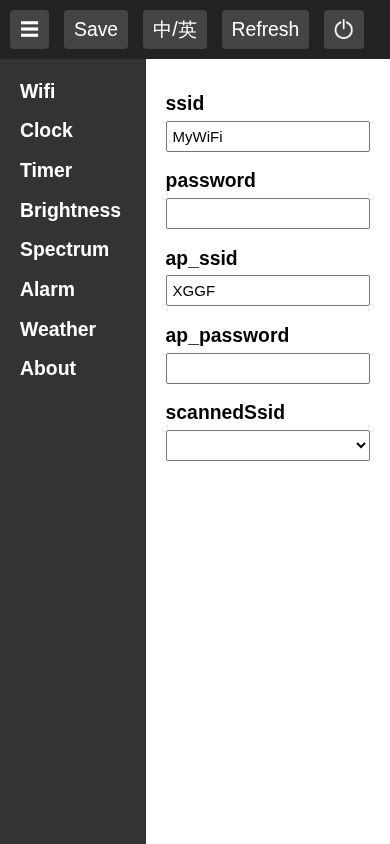
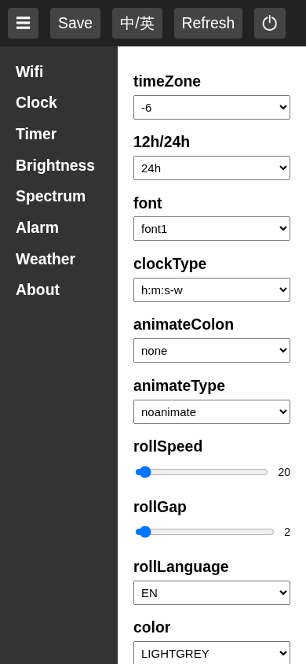
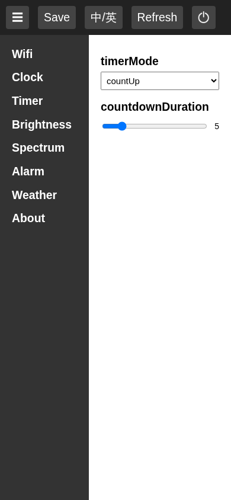
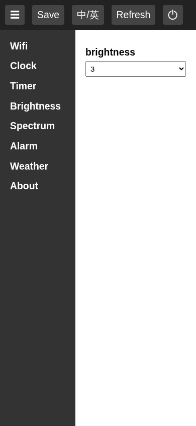
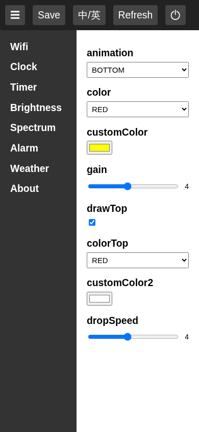

# Stock web page and API (v1.1)

How the stock firmware's configuration page talks to the clock. Found by reading the page source and the stored `config.json` from a stock unit. No vendor code is reproduced here.

## How it is served

- The clock runs its own access point (SSID from `ap_ssid`, default `XGGF`) and also joins your WiFi as a station.
- The page is a single HTML file stored on the LittleFS partition. It is served by an AsyncTCP web server.
- Phones and laptops pop the page open in their captive portal mini browser when they join the clock's WiFi (reported on a real unit, the firmware side was not inspected). That browser is limited, which is the main reason to replace this page.
- The page starts in Chinese. The EN/ZH button toggles the language in the page only, nothing is stored.

## Endpoints

| Method | Path | Body | Purpose |
|---|---|---|---|
| GET | `/` | | The config page |
| GET | `/getConfigs` | | Full config JSON (see below) |
| POST | `/saveConfigs` | JSON, the `webConfig` object only | Save everything, reply is JSON, the page then shows "Config Saved !!" |
| POST | `/action` | form field `message=<text>` | Live change, see below |
| POST | `/uploadBin` | multipart form, field `image` | OTA firmware upload. The page only accepts a file named `firmware.bin` |

`/action` messages are sent as the user edits, before saving, so the clock can preview the change:

- `<Section>-<field>:<value>` for every changed field, for example `Brightness-brightness:5`
- `Wifi-ssid:<ssid>` when an SSID is picked from the scan list
- `<Section>:change section` when the user opens a section
- `PowerOff` from the power button

## Config format

`/getConfigs` returns:

```json
{
  "webConfig": { "<Section>": [ { "name": "...", "name_zh": "...", "type": "...", "value": "..." } ] },
  "configVersion": "1.1",
  "softwareVersion": "1.1"
}
```

The page is generated from this data, so adding a field to the JSON adds a control. Field types: `text`, `select` (with `list` and optionally `list_zh`), `range` (with `range: [min, max]`), `colorpicker` (`#RRGGBB`), `switch`, `time` (`HH:MM`, empty means off), `multi` (7 checkboxes).

The `multi` value is a 7 character string, `O` for checked and `X` for unchecked, for example `XXXXXXX`. Which index is which weekday is not confirmed.

## Sections and fields

Defaults are from a stock unit.

Screenshots are from a local mock of the page with private values removed.

**Wifi**: `ssid`, `password`, `ap_ssid`, `ap_password` (text), `scannedSsid` (select, filled by the clock with nearby networks).



**Clock**
- `timeZone`: select, -12 to +12 (whole hours)
- `12h/24h`: `12h`, `24h`
- `font`: `font1` to `font6`
- `clockType`: `h:m:s`, `h:m:s-w`, `y-m-d`, `time-date`, `rolling`, `weather-time`
- `animateColon`: `wink`, `none`
- `animateType`: `noanimate`, `animate1` to `animate3`
- `rollSpeed`: range 20 to 100
- `rollGap`: range 2 to 10
- `rollLanguage`: `EN`, `中`
- `color`: `LIGHTGREY`, `BLUE`, `GREEN`, `CYAN`, `RED`, `MAGENTA`, `YELLOW`, `WHITE`, `ORANGE`, `GREENYELLOW`, `PALERED`, `CUSTOM`
- `customColor`: color picker, used when `color` is `CUSTOM`
- `ntpServer`: `ntp1.aliyun.com`, `ntp2.aliyun.com`
- `timePowerON`, `timePowerOFF`: time, scheduled screen on and off



**Timer**: `timerMode` (`countDown`, `countUp`), `countdownDuration` (range 1 to 30).



**Brightness**: `brightness`, `1` to `10` or `Auto` (uses the photoresistor on GPIO0).



**Spectrum** (music visualizer using the microphone)
- `animation`: `MID`, `BOTTOM`, `GAP`, `TOP`
- `color`, `customColor`: same color list as the clock
- `gain`: range 1 to 8
- `drawTop`: switch, draw the falling peak marker
- `colorTop`, `customColor2`: peak marker color
- `dropSpeed`: range 1 to 8



**Alarm**: five alarms, each `alarmtimeN` (time) and `alarmRepeatN` (`multi`).


**Weather**: `location` (text), `token` (text, an AMap API key), `autoWeatherGap` (minutes: 5, 10, 30, 60, 240, 1440).


## Notes for a replacement

- Settings are stored in `config.json` on LittleFS, and the WiFi credentials also end up in NVS. Both hold the WiFi password, so a config export should leave credentials out.
- The page code has no login. The stored config contains the WiFi password and the weather key, and the page loads it through `/getConfigs`, so it is likely readable by anyone on the same network (server side not tested).
- The timezone control only supports whole hours.
